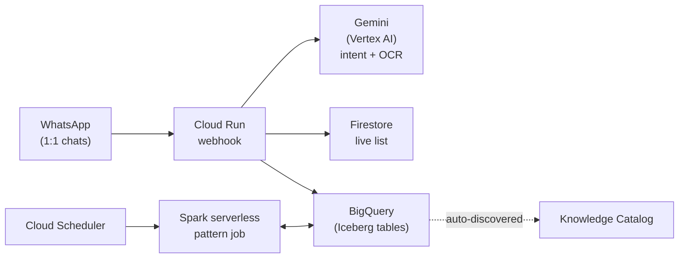

# Nano 🛒

Nano is a WhatsApp assistant that helps a couple manage one shared grocery list — add items by text, log receipts by photo, and ask questions about past spending — built as a hands-on demonstration of an open-format lakehouse (Apache Iceberg via BigQuery) alongside Gemini and Cloud Run.

## What it does

- **Add items** — "we're out of coffee" gets parsed and appended to the shared list.
- **View the list** — "what's on the list?" returns current items.
- **Remove items** — "remove milk" takes it off.
- **Close the list** — clear everything out after a shopping trip.
- **Log a receipt** — send a photo; Gemini extracts store, date, total, and line items, logs them, and clears matching items off the live list.
- **Ask about spending** — "how much did we spend this month?", "when did we last buy olive oil?"

Nano runs as two separate 1:1 WhatsApp chats rather than a group — the WhatsApp Business Platform doesn't support adding a bot into an existing personal group chat, so Nano fans out updates to both people from one shared backend state instead.

## Architecture



- **Cloud Run** hosts the FastAPI webhook that receives WhatsApp messages.
- **Gemini** (Vertex AI) classifies every text message into an intent via function calling, and reads receipt photos directly as multimodal input.
- **Firestore** holds the live, frequently-changing shopping list.
- **BigQuery, using BigLake tables for Apache Iceberg**, holds purchase history (`purchases`, `purchase_items`, `list_events`) — an open table format backed by a Cloud Storage bucket you own, queryable by BigQuery today and by other engines (Spark, Trino, etc.) without copying data.
- **GitHub Actions**, authenticated via Workload Identity Federation (no service account key ever touches the repo), deploys automatically to Cloud Run on every push to `main`.

## Repo structure

```
app/              Cloud Run service (FastAPI webhook, Gemini + Firestore + BigQuery logic)
sql/              Iceberg table DDL
spark-jobs/       Serverless Spark job(s) for pattern detection (planned)
docs/             Project history and notes
.github/workflows/  CI/CD pipeline
```

## Running this yourself

You'll need:
- A Google Cloud project with Firestore, BigQuery, Vertex AI, Cloud Run, and Secret Manager enabled
- A WhatsApp Business Cloud API app (via [Meta for Developers](https://developers.facebook.com))
- A GitHub repo with Workload Identity Federation configured for keyless deploys (see `.github/workflows/deploy.yml`)

At minimum, the Cloud Run service expects these environment variables and one mounted secret:

| Variable | Purpose |
|---|---|
| `VERIFY_TOKEN` | Confirms webhook ownership during Meta's setup handshake |
| `PHONE_NUMBER_ID` | Your WhatsApp Business phone number ID |
| `HOUSEHOLD_NUMBERS` | Comma-separated list of numbers Nano replies to |
| `WHATSAPP_ACCESS_TOKEN` (secret) | Permanent WhatsApp API access token, via Secret Manager |

## Known limitations

- Tested reliably for one active user; the second household member's number is currently blocked by a Meta cross-border messaging restriction unrelated to this codebase.
- No conversational memory yet — each message is classified independently, so short follow-ups or corrections aren't understood in context.
- Receipt extraction accuracy depends on Gemini's read of the photo and hasn't been hardened against unusual receipt formats.
- Intentionally uses Iceberg/Lakehouse tooling at a scale where it isn't strictly necessary — a deliberate choice to demonstrate the architecture cheaply and clearly, not a scale requirement.


## License

MIT (or update to match whatever you've actually added to `LICENSE`).
