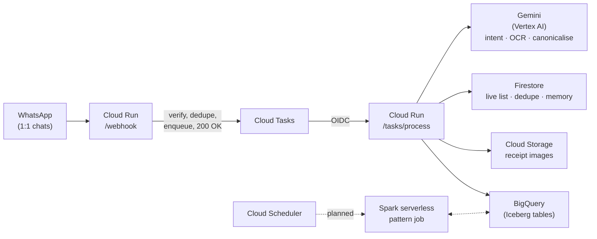

# Nano 🛒

Nano is a WhatsApp assistant that keeps one shared grocery list for a couple — add items by
text, log receipts by photo, and ask questions about past spending. It is a working demo of
an open-format lakehouse (Apache Iceberg via BigQuery) alongside Gemini and Cloud Run.

## What it does

- **Add, view, remove** — "we're out of coffee", "what's on the list?", "remove milk".
- **Undo** — reverses the last change.
- **Clear the list** — after a shop. It confirms first, because that one is destructive.
- **Log a receipt** — send a photo. Gemini reads the store, date, total and every line item,
  records the purchase, and ticks off whatever you had already listed.
- **Ask about spending** — "how much did we spend this month?", "what did we buy?", "when did
  we last buy olive oil?"
- **Follow-ups work.** The last few exchanges are carried into each message, so "no, the decaf
  one" and "remove that" resolve against what was just said.

Item names are canonicalised across languages, so a receipt line printed `POMA GOLDEN 1KG`
is found by a question about apples. That matters more than it sounds: when the receipts are
in Catalan and the questions are in English, the two words often share no letters at all.

Nano runs as two separate 1:1 chats rather than a group — the WhatsApp Business Platform does
not allow adding a bot to an existing personal group — so it fans changes out to both people
from one shared backend.

## Architecture



The webhook's only job is to decide, in milliseconds, whether a payload is genuine and worth
processing — then hand it to Cloud Tasks and return 200. Everything slow happens off the
request path. This is not incidental: doing that work inline once produced 82-second
latencies, a Meta retry storm, and seven copies of one receipt.

- **Cloud Run** hosts the FastAPI service. `/webhook` acknowledges; `/tasks/process` does the
  work in a worker thread so blocking calls never stall the event loop.
- **Cloud Tasks** provides retries with backoff, and — because task names derive from the
  WhatsApp message id — rejects a redelivery before anything else runs.
- **Firestore** holds the live list, the message-deduplication ledger, and conversation memory.
- **BigQuery, using BigLake tables for Apache Iceberg**, holds history (`purchases`,
  `purchase_items`, `list_events`) — an open table format backed by a Cloud Storage bucket you
  own, queryable by BigQuery today and by Spark or Trino without copying data.
- **Cloud Storage** archives every receipt image, so an extraction can be checked against the
  original and receipts can be reprocessed after improving the prompt.
- **Gemini** classifies intent by function calling, reads receipt photos directly, and maps
  item names to canonical English terms.
- **GitHub Actions**, via Workload Identity Federation, runs tests and then deploys.

## Repo layout

```
app/
  main.py              Cloud Run entrypoint
  Dockerfile           pinned Python, non-root
  nano/
    config.py          environment parsing and validation
    routes.py          /webhook, /tasks/process, /health
    whatsapp.py        signatures, inbound parsing, sending
    tasks.py           Cloud Tasks dispatch and OIDC verification
    store.py           Firestore: list, dedupe, conversation memory
    handlers.py        intent -> action -> reply
    gemini.py          classification and receipt extraction
    canonicalise.py    cross-language item mapping
    receipts.py        image archival and date sanity checks
    purchases.py       Iceberg writes
    events.py          list_events
    history.py         spending questions
    clients.py         lazily-built GCP clients
    logging_setup.py   structured logs
sql/                   Iceberg DDL and migrations
scripts/               setup and local development
tests/
  unit/                offline, fakes for every external service
  integration/         real GCP, against a separate test dataset
  fakes/
```

## Running the tests

```bash
uv venv --python 3.12 .venv
uv pip install --python .venv/bin/python -r requirements-dev.txt

.venv/bin/python -m pytest tests/unit -q     # offline, no credentials, seconds
.venv/bin/ruff check . && .venv/bin/ruff format --check .
```

Unit tests cannot make network calls — `conftest.py` blocks them, because a hang in CI is
worse than a failure.

The integration tier runs against real BigQuery, Firestore, Cloud Storage and Vertex AI, in a
**separate dataset** so it can never touch live household data:

```bash
./scripts/setup_test_dataset.sh              # creates nano_test, once
gcloud auth application-default login        # tick the cloud-platform scope

GOOGLE_CLOUD_PROJECT=<project> BQ_DATASET=nano_test FIRESTORE_PREFIX=nano_test_ \
  .venv/bin/python -m pytest tests/integration -m integration -q
```

Pointing `BQ_DATASET` at the production dataset makes every integration test fail before a
single client call — deliberately.

## Running it locally

```bash
cd app
TASK_BACKEND=inline VERIFY_TOKEN=local PHONE_NUMBER_ID=000000000000000 \
HOUSEHOLD_MEMBERS="15550100001:you" WHATSAPP_APP_SECRET=local-secret \
  ../.venv/bin/uvicorn main:app --reload --port 8080
```

Then drive it with correctly-signed payloads — no phone, no Meta, no cost:

```bash
python scripts/replay_webhook.py text "add coffee"
python scripts/replay_webhook.py duplicate    # same id twice
python scripts/replay_webhook.py forged       # bad signature -> 403
python scripts/replay_webhook.py stranger     # unknown sender -> ignored
python scripts/replay_webhook.py status       # delivery callback -> ignored
```

## Deploying it yourself

You'll need a Google Cloud project with Cloud Run, Firestore, BigQuery, Cloud Tasks, Cloud
Storage, Vertex AI and Secret Manager enabled; a WhatsApp Business Cloud API app; and a GitHub
repo with Workload Identity Federation configured.

```bash
./scripts/setup_test_dataset.sh    # BigQuery datasets and Iceberg tables
./scripts/setup_cloud_tasks.sh     # queue, invoker identity, IAM
./scripts/setup_app_secret.sh      # Meta App Secret -> Secret Manager
./scripts/setup_firestore_ttl.sh   # expire dedupe records
```

### Configuration

Nothing identifying is hardcoded. Workflows read repository secrets; the app reads the
environment.

| Variable | Purpose |
|---|---|
| `VERIFY_TOKEN` | Meta's webhook subscription handshake |
| `PHONE_NUMBER_ID` | Your WhatsApp Business phone number id |
| `HOUSEHOLD_MEMBERS` | `<number>:name;<number>:name` — **semicolon-separated**, see below |
| `WHATSAPP_ACCESS_TOKEN` | Secret Manager. Never hardcode |
| `WHATSAPP_APP_SECRET` | Secret Manager. Enables signature verification |
| `REQUIRE_SIGNATURE` | Enforce signatures. Off until the app secret is real |
| `HOUSEHOLD_TIMEZONE` | e.g. `Europe/Madrid`. "today" is wrong in UTC |
| `DEFAULT_CURRENCY` | Fallback when a receipt does not say |
| `RECEIPTS_BUCKET` | Where receipt images are archived |
| `BQ_DATASET` | `nano` in production, `nano_test` for tests |
| `FIRESTORE_PREFIX` | Namespaces collections in tests |
| `TASK_BACKEND` | `cloud_tasks` or `inline` |
| `TASKS_QUEUE`, `TASKS_LOCATION`, `TASKS_TARGET_URL`, `TASKS_INVOKER_SA` | Cloud Tasks |
| `GOOGLE_CLOUD_PROJECT` | Optional; resolved from credentials when absent |

> **`HOUSEHOLD_MEMBERS` is semicolon-separated on purpose.** The Cloud Run deploy action's
> `env_vars` input is comma-delimited, and a comma inside a value is split rather than
> escaped. A comma-separated list silently became one truncated variable plus two junk ones,
> and the service messaged one person for weeks. The app accepts `;`, `|` or `,`, and the
> deploy fails the build if the value contains a comma.

## Known limitations

- Tested with one active user. The second household member's number is subject to a Meta
  cross-border messaging restriction (`130497`) unrelated to this codebase; an undeliverable
  recipient is now a log line rather than an outage.
- Signature verification ships **off** until a real Meta App Secret is stored, because
  enabling it with a placeholder would reject every genuine webhook.
- Receipt extraction accuracy depends on Gemini's read of the photo. Dates are sanity-checked;
  totals are not reconciled against line items.
- `list_events` is populated but the Phase 4 shopping-pattern job is not built yet — it needs
  a few weeks of accumulated data first.
- The Vertex `generative_models` SDK in use is deprecated, with removal scheduled for June
  2026. Migration to `google-genai` is pending.
- Iceberg and serverless Spark are used at a scale where they are not strictly necessary. That
  is a deliberate choice to demonstrate the architecture cheaply, not a scale requirement.

## License

MIT.
