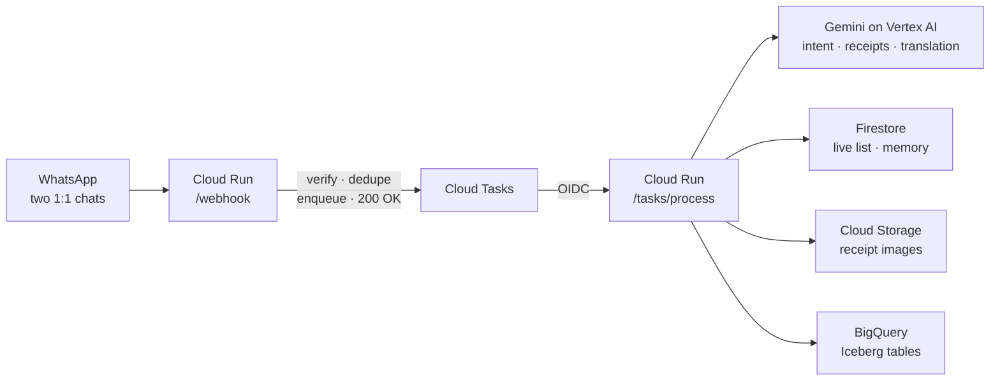
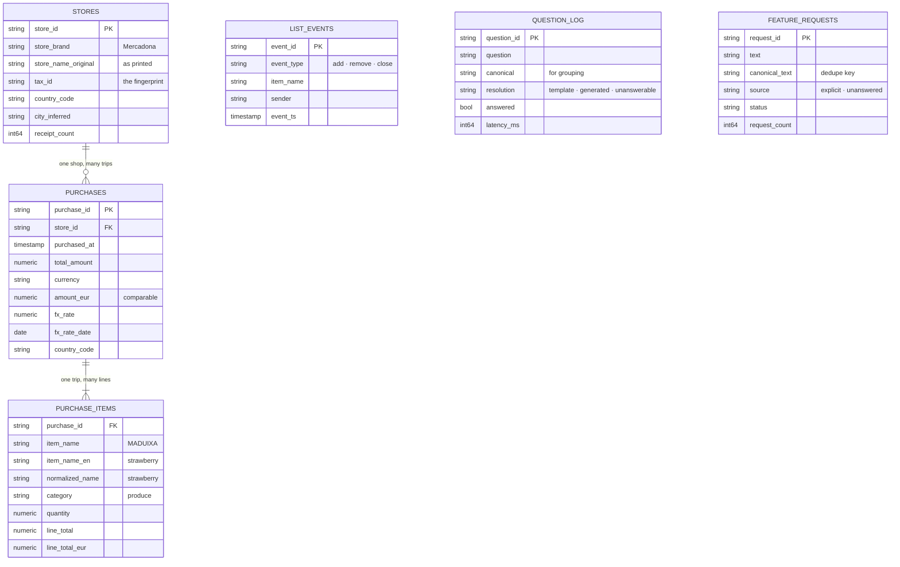
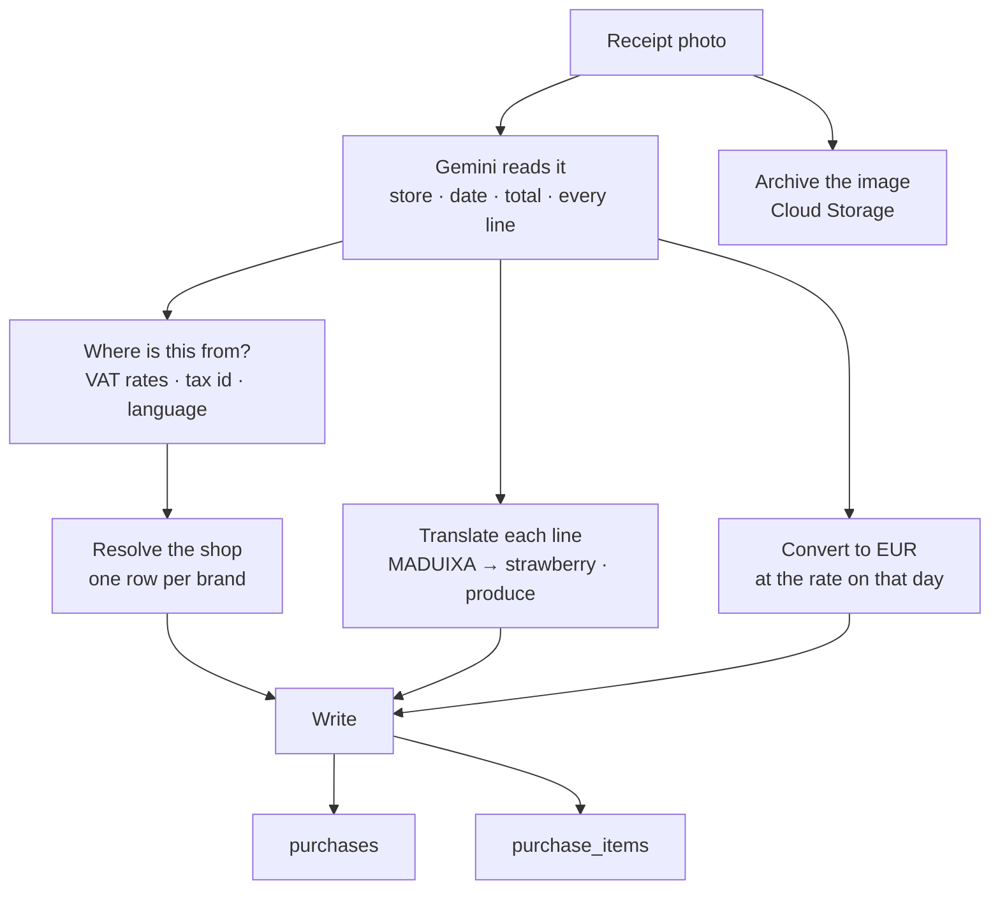
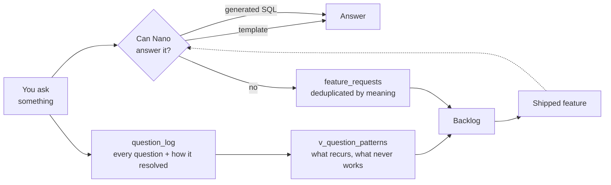

# Nano: a WhatsApp grocery assistant, and the lakehouse under it

My wife and I do one big supermarket run a week. For a long time the list for it lived in our
WhatsApp conversation, which is another way of saying it did not really live anywhere.

Someone would write "we're out of coffee" on a Tuesday. By Saturday that message sat twenty
messages up, buried between a photo of something one of us had seen and a conversation about
the weekend. We would stand in an aisle scrolling backwards through the chat, trying to
reconstruct a list out of fragments, and still come home without the coffee.

So I built Nano: a small assistant that lives in the same WhatsApp conversation we were already
having, keeps one shared list for both of us, and remembers what we bought.

I also had a second motive, and it is worth admitting up front. I wanted to learn Google's
open-format lakehouse tooling — Apache Iceberg tables in BigQuery — and I have never learned
anything properly from a tutorial dataset. Our groceries were data I actually cared about being
right, at a volume where being wrong cost nothing. That turned out to be the ideal teacher.

---

## 1. The problem, and the one that came after it

The first problem was simply that a chat thread is not a list. It has no state. Nothing in it
can be ticked off, and by the time you need it, it has scrolled away.

The obvious answer is to put a bot in the group chat, and that answer is not available.
WhatsApp's Business Platform does not let you add an API number to an existing personal group —
it is a deliberate restriction, not a gap you can engineer around. So Nano runs as **two
separate one-to-one chats sharing a single backend**. When either of us changes the list, both
phones hear about it. It behaves like a shared assistant without being one, and after a few
weeks you stop noticing the difference.

The second problem arrived with the first receipt, and it is the one that shaped everything
underneath.

We live in Barcelona, and our receipts print in Catalan. A line reads `MADUIXA`. Another reads
`PASTANAGA 500 G`. A third says `PIT FAM.`, which even I had to think about. The questions I
wanted to ask were in English — *how much do we spend on strawberries?* — and no amount of
clever database searching will ever connect "strawberries" to `MADUIXA`. The two words do not
share a single letter.

That settled an important design point very early: whatever I built had to understand each line
**at the moment it was stored**, not at the moment it was asked about. Translation is part of
writing the data, not part of reading it.

> **[Screenshot: adding items to the list]**
> _Caption: free text in, a shared list out._

---

## 2. What it actually does

Everything happens in the chat we already use. There are no commands to memorise, which was a
requirement rather than a nicety — my wife was never going to learn a syntax, and she was
right not to.

| You say | Nano does |
|---|---|
| "we're out of coffee" | adds it, and tells the other phone |
| "what's on the list?" | shows the shared list |
| "remove milk" / "undo" | takes it off, or reverses the last change |
| "clear the list" | confirms first — this one is destructive |
| *(photo of a receipt)* | reads the store, date, total and every line; ticks off what was on the list |
| "how much did we spend this month?" | answers from the purchase history |
| "what is family pack breast?" | explains a line from the receipt it read |
| "which AI model do you use?" | answers honestly about itself |

Follow-up messages work, because the last few exchanges travel with each new one. "No, the
decaf one" and "show me that again" resolve against whatever was just said, which sounds small
and is the difference between something you use and something you abandon.

> **[Screenshot: asking about past spending]**
> _Caption: a question answered from the purchase history._

> **[Screenshot: a receipt logged, items listed in English]**
> _Caption: `strawberry (MADUIXA)` — English first, what the shop actually printed in brackets._

---

## 3. The shape of it



The webhook has exactly one job: decide in milliseconds whether an incoming message is genuine
and worth processing, hand it to [Cloud Tasks](https://cloud.google.com/tasks/docs), and return
`200`. Everything slow happens somewhere else.

I would like to claim that was foresight. It was not — it was a lesson. The first version did
all the work inline, which meant a receipt photo held the connection open for 82 seconds while
Gemini read it. Meta treats a slow webhook as a failed one and retries it, so a single
photograph of a single receipt became seven identical purchases in the database, and our
monthly grocery total was wrong by a factor of seven. Moving the work behind a queue fixed the
latency and the duplicates in one change.

Reading the messages themselves uses [Gemini's function
calling](https://cloud.google.com/vertex-ai/generative-ai/docs/multimodal/function-calling).
The model does not write the reply; it chooses one of [fourteen
functions](https://github.com/hugozanini/nano/blob/6a908a3bf93c306f0db78c108889f424994b2cf9/app/nano/gemini.py#L117-L390)
and fills in its arguments, and the code decides what to do. Receipt photos go to the same model, so there is no
separate OCR service anywhere in the stack.

---

## 4. Why a lakehouse for a household

There are two kinds of data here, and they want completely different things.

The **live shopping list** is read and written constantly, is a few dozen words long, and has no
analytical value whatsoever on its own. It needs to be fast and simple, and it lives in
[Firestore](https://cloud.google.com/firestore/docs).

The **purchase history** is the opposite. It is written once per shopping trip, never modified,
and exists entirely so that questions can be asked of it later. That is the part worth putting
in a lakehouse: six [Apache Iceberg managed
tables](https://cloud.google.com/bigquery/docs/biglake-iceberg-tables-in-bigquery) in BigQuery,
which until recently were called "BigLake tables for Apache Iceberg".

If Iceberg is unfamiliar, the short version is this. It is an open table format: your data sits
as ordinary Parquet files in a bucket **you own**, alongside metadata files describing the shape
of the table. BigQuery gives you the fully managed experience — plain SQL, no servers — but the
files are yours, in your bucket, in a format other engines can read. Nothing is trapped.

Creating one is unremarkable, which is the appeal:

```sql
CREATE TABLE `<dataset>.purchases` (
  purchase_id  STRING,
  purchased_at TIMESTAMP,
  store_name   STRING,
  total_amount NUMERIC,
  currency     STRING
)
WITH CONNECTION `<region>.<connection>`
OPTIONS (
  table_format = 'ICEBERG',
  file_format  = 'PARQUET',
  storage_uri  = 'gs://<your-bucket>/warehouse/purchases'
);
```

You write to it with normal `INSERT` and `MERGE`. There is no catalog service to operate. The
only piece of plumbing is a [BigQuery
connection](https://cloud.google.com/bigquery/docs/connections-api-intro) whose service account
is allowed to write into your bucket.

### How the data is modelled

Six tables, in three groups that never really touch each other:



Three deliberate choices are buried in that diagram.

**Every line item keeps three names.** `item_name` is what the shop printed, `item_name_en` is
the English translation, and `normalized_name` is the canonical term used for matching. Keeping
all three is what lets Nano answer a question about strawberries, reply in English, and still
show you the Catalan text that is actually on the paper in your hand.

**`stores` is a separate table**, and shops are resolved to it once. A supermarket brand prints
its name slightly differently across receipts, and without a stable `store_id` every one of
those spellings becomes its own shop, quietly splitting your spending across four rows that
should be one.

**Money is stored twice.** `total_amount` with its `currency` is what was actually charged.
`amount_eur` is the same figure converted at `fx_rate`, using the rate from `fx_rate_date` —
the day of the purchase, not today. It means totals from last year still reconcile.

`list_events`, `question_log` and `feature_requests` have no relationships at all. They are
append-only logs, and the last two are what section 6 is about.

### The part that earned its keep

Here is what happens when a receipt photo arrives:



None of those steps existed on day one. Each was added because a question I wanted to ask
turned out to be unanswerable, and each one needed somewhere new to put its answer.

This is where Iceberg quietly justified itself. The `purchases` table started with seven
columns and now has twenty-one:

| Added later | Because |
|---|---|
| `receipt_language`, `country_code`, `city_inferred` | working out where a receipt came from |
| `tax_rates`, `tax_id` | VAT rates are a reliable fingerprint for a country |
| `store_id` | one row per shop, so totals stop splitting |
| `amount_eur`, `fx_rate`, `fx_rate_date` | one comparable currency, at the rate on the day |

Every one of those arrived as an additive `ALTER TABLE ... ADD COLUMN IF NOT EXISTS`, run
against a table that already held real data, while the assistant carried on answering messages.
Existing rows simply get `NULL`. Nothing is rewritten, there is no backfill, and there is no
migration window. Ten numbered SQL files, applied in order, are the entire history of the schema.

For a project that changes shape every weekend, that property mattered far more than any
query-performance argument.

**One honest caveat.** This is a household's groceries — three shopping trips and thirty-four
line items at the time of writing. Iceberg is comically oversized for that, and I chose it
anyway, deliberately, because I wanted to learn it somewhere the stakes were zero. If you are
weighing this for real work, match the tool to the problem. Just be clear with yourself about
which one you are doing.

---

## 5. Product decisions that cost something

**Answer in English, always.** Receipts arrive in Catalan or Spanish; every answer comes back in
English, with the printed name preserved in brackets — `strawberry (MADUIXA)`. Standardising is
the thing Nano is *for*, so this is a promise rather than a preference. Keeping the original
alongside costs a few characters and means you can still find the line on the paper receipt when
you are checking a total.

**Stop rather than guess.** Asked *"What is family pack breast? Chicken breast?"*, Nano explains
what the receipt contains — the printed text, its reading of it, the category, the price — and
then deliberately stops:

> That's my reading of the abbreviation on the receipt — it doesn't record anything beyond the
> printed name, so I can't confirm more than that.

It is almost certainly chicken. Saying so would have been correct by luck and wrong by method,
and I know that because of a bug that still makes me wince. A generated query once returned an
unnamed column containing `3.11`, and with no column name to go on, the model reported
**"$3.11" for a purchase made in euros**. It was not flagged as a guess. It read exactly like an
answer. A language model fills gaps in its input silently and plausibly, and the only real fix
is never to leave the gap.

**Ask, but rarely.** When a message genuinely has two readings, Nano asks which you meant. The
risk here is obvious and severe: an assistant that checks constantly is far more annoying than
one that occasionally guesses wrong. So the restraint is measured rather than hoped for —
across twelve unambiguous messages tested against the real model, it asks **zero** times.

> **[Screenshot: Nano explaining a receipt line, and declining to guess]**
> _Caption: what the receipt says, and where the receipt stops._

---

## 6. The loop: Nano files its own backlog

This is the part I did not plan, and the part I would build first next time.

Every question gets logged along with how it was resolved: answered from a hand-written SQL
template, answered by SQL the model generated on the spot, or not answered at all.



A question that nothing could answer is the clearest product signal available: someone wanted
something and did not get it. The catch is that nobody files a ticket for a grocery bot — my
wife is certainly not going to — so Nano files it instead. Requests are deduplicated on meaning,
so three different phrasings of the same idea become one row with a count of three. That turns a
pile of utterances into a rough measure of demand.

It works better than I expected. Of the five items in the backlog right now, three were filed by
Nano itself, and all three have since shipped:

| Nano recorded | Became |
|---|---|
| "translate the list to English" | English item names everywhere |
| "what family pack breast is" | explaining any line on a receipt |
| "which AI model you use" | answering questions about itself |

**The failure in that table matters more than the successes.** The very first row was "what
family pack breast is" — a question Nano already had every single fact needed to answer. It had
translated `PIT FAM.` itself, minutes earlier, in the same conversation. Refusing to answer was
bad. Filing a feature request for a feature that already existed was considerably worse, because
the backlog is the thing that decides what gets built next.

Answering wrongly misleads one person once. Filing wrongly misleads the roadmap.

> **[Screenshot: "which AI model do you use?"]**
> _Caption: a question Nano used to refuse, and now answers._

---

## 7. Where it stands

Nano runs for a few dollars a month. Cloud Run scales to zero between messages, the Gemini calls
are small, and BigQuery at this volume disappears into the free tier. Secrets live in [Secret
Manager](https://cloud.google.com/secret-manager/docs) and deploys authenticate through
[Workload Identity Federation](https://cloud.google.com/iam/docs/workload-identity-federation),
so there are no downloadable keys anywhere in the project.

Three things surprised me, and they are what I would pass on.

**The receipts taught the schema.** Every column I added after the first week — the country, the
tax rates, the exchange rate and the date it applied — existed because a question I wanted to
ask turned out to be unanswerable. I could not have designed that table up front, and with
Iceberg I did not have to: each answer arrived as one additive `ALTER TABLE` against live data,
with no backfill and nothing taken offline. For a project that changes shape every weekend,
that mattered more than any performance argument.

**Where the model stops is a product decision.** The temptation with a language model is to let
it fill every silence, because it always can, and it always sounds right. The euro reported as
a dollar taught me otherwise: it was not flagged as a guess, it simply read like an answer.
Nano is more useful for saying "the receipt does not record that" than it would be for being
confidently wrong twice a month.

**Letting it file its own backlog changed what I built.** Three of the features in this article
exist because Nano recorded a question it could not answer and I read the table later. That is
a better product signal than my own intuition about what was missing, and it cost about forty
lines of code.

What is here now is genuinely further along than the data in it — three shopping trips is not a
trend, and most of the interesting spending questions still cannot be answered for want of
receipts rather than code. The serverless Spark job that was meant to learn our shopping day is
still unwritten, waiting on months of history, and no second engine has yet read these Iceberg
files, which is the real argument for an open format and something I would like to actually
demonstrate rather than assert.

All of which is to say it is a side project, and it is in exactly the place side projects live.

The list works, though. We have stopped forgetting the coffee.

---

## Try it, or take it apart

Nano is open source at **[github.com/hugozanini/nano](https://github.com/hugozanini/nano)** —
the full application, the Iceberg schema as numbered migrations, and the test suite.

**Contributions are very welcome.** If you want somewhere to start: the Spark job for shopping
patterns is unwritten, the analytics layer could cache repeated questions instead of
regenerating their SQL, and receipt totals are not yet reconciled against their line items. Bug
reports from anyone whose receipts print in a language I have not tested would be especially
useful — that is precisely where this thing is weakest, and the part I cannot test alone.
